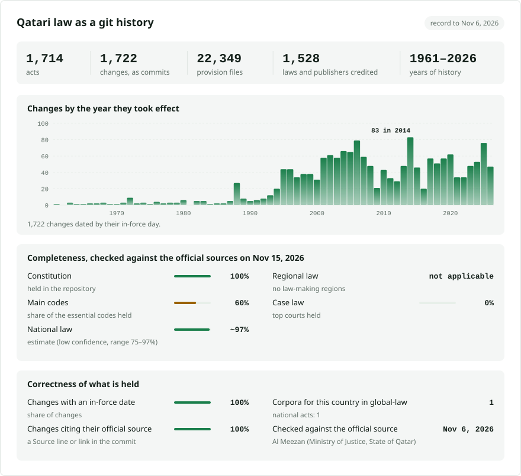

# Qatar: law history in git

[العربية](README.md) · **English**

<picture>
<source media="(prefers-color-scheme: dark)" srcset="data/effort-dark.svg">

</picture>

The law of Qatar as a git history: one file per article, one commit per version on the day it took effect, and the act that made each change as the commit's author. `git blame` names the act behind every article; `git log` lists every change to an article; picking a date gives the text in force that day.

Part of [lexifina/global-law](https://github.com/lexifina/global-law), one git history for every country's law: this is Qatar's national law, which global-law reads at `qatar/national/acts/`.

**What is in it now:** the Constitution and 1,713 acts from Al Meezan, the Ministry of Justice's legal portal, with 1,722 versions: 581 laws, 125 decree-laws, 300 Amiri decisions (1996-2013) and 707 decisions of the Council of Ministers (1994-2026). The Constitution (2 versions, the second from the 2024 amendments) and the Penal Code (8 versions, 2004 to 2024) have their full dated history; 188 acts Al Meezan shows as amended are here as today's text only; every other act is here as issued. [`data/laws.csv`](data/laws.csv) lists every act with its title and its page on Al Meezan; [`data/versions.json`](data/versions.json) lists each act's versions.

Each act is a folder named `<kind>-<year>-<number>/`, with one file per article (`law-2004-14/` is قانون العمل, the Labour Law, Law No. 14 of 2004, and `law-2004-14/art-079.md` its Article 79, on annual leave); the first three acts recorded keep their own names: [`dustur/`](dustur/) (the Constitution), [`qanun-al-uqubat/`](qanun-al-uqubat/) (the Penal Code, Law No. 11 of 2004) and [`himayat-al-bayanat-al-shakhsiya/`](himayat-al-bayanat-al-shakhsiya/) (Law No. 13 of 2016 on personal data). Each folder's `README.md` lists its articles.

The text is in Arabic, the authoritative text, as Al Meezan publishes it. Al Meezan's English translations are partial and unofficial and are not part of this record.

## Questions as git commands

| Question | Command |
| --- | --- |
| Every change to Article 333 of the Penal Code (privacy) | `git log -p --word-diff -- qanun-al-uqubat/art-333.md` |
| Which law wrote each line of Article 333? | `git blame qanun-al-uqubat/art-333.md` |
| Every version of the Penal Code, with the day each took effect | `git log --format="%h %(trailers:key=In-force,valueonly,separator=) %an" -- qanun-al-uqubat ":^qanun-al-uqubat/README.md"` |
| Article 333 as in force on 1 January 2015 | `python tools/on.py 2015-01-01 qanun-al-uqubat art-333` |

**Outside git**, we also host this record publicly, for free:

- **[Ask Claude about Qatari law](https://global-law.lexifina.com/v1/try_claude?country=qatar)**: opens Claude with a first question ready.
- **[Ask ChatGPT](https://global-law.lexifina.com/v1/try_chatgpt?country=qatar)**: the same question in ChatGPT.
- **[Search Qatari law on our site](https://lexifina.com/law?country=qatar&q=%D8%A5%D8%AC%D8%A7%D8%B2%D8%A9+%D8%B3%D9%86%D9%88%D9%8A%D8%A9)**: a search for "إجازة سنوية" (annual leave), with each provision's text and its versions, no account needed.
- **[Developer REST API](https://global-law.lexifina.com/v1/search_law?query=%D8%A5%D8%AC%D8%A7%D8%B2%D8%A9+%D8%B3%D9%86%D9%88%D9%8A%D8%A9&jurisdiction=qatar)**: the same search as JSON, with no key. See the [documentation here](https://lexifina.com/api/global-law).

Both assistants read the record through the free Global law connector (MCP, `https://global-law.lexifina.com/mcp`); the first time, the chat gives you the link that adds it. Ask in Arabic or in English.

**Host it yourself easily.** All it takes is git and Python, and the tools run on your machine:

```sh
git clone --depth 1 https://github.com/lexifina/global-law && cd global-law
python3 tools/countries.py add qatar/national/acts
python3 tools/law.py show 2026-01-01 qatar/national/acts/qanun-al-uqubat/art-333.md
```

Opened in Claude Code, Cursor, VS Code or Codex, the clone also starts a local MCP server with the same tools ([MCP.md](https://github.com/lexifina/global-law/blob/main/MCP.md)).

## Dates

Each commit is dated at noon, Asia/Qatar, on the day the version took effect, and carries it in its `In-force:` trailer:

- the act's own in-force clause, where the record allows it to be counted (a fixed day, or a period from its issue or its publication in the Official Gazette); the 2024 constitutional amendments took effect when the referendum result was announced, 6 November 2024 (their Article 2);
- with no such clause, a law or decree-law published from 9 June 2005 takes effect one month after publication (Constitution, Article 142) and an earlier one is dated by its day of issue; a decision is dated by its Gazette day, or by its day of issue where Al Meezan records only the Gazette's year. Each act's rule is in `REPRODUCE.md`;
- git cannot store dates before 1970, so the 14 earlier commits (laws and decree-laws of 1961 to 1969) are dated 1970-01-01, with the real day in `In-force:`. Ask for a date with `tools/on.py`, not `git log --before`.

Each change to the Constitution and the Penal Code is credited to the law that made it, as Al Meezan's history of each article names it. Every other act's one version is credited to the act itself (1,526 acts) or, where Al Meezan shows it as amended, to the publisher, Al Meezan, as the "oldest version available" (188). The committer is Lexifina.

## How it is checked

- `tools/check_repo.py` reads every version back from git on the day it took effect and on the day before and compares it with the corpus, whose hash is in `data/corpus.sha256`; it also checks that every commit's trailers parse, that `main` has no merge commits and that no commit is dated after the build. [`REPRODUCE.md`](REPRODUCE.md) records 1,722 versions of 1,714 acts read back with no mismatch.
- Each Amiri and Council of Ministers decision is also compared with Al Meezan's Akoma Ntoso XML, which must carry the same Arabic text; one that does not is left out.
- `tools/build.py` writes the history from the corpus, and the same corpus gives the same commit hashes; `tools/append.py` adds new acts and versions on top and never rewrites. No second build has been compared yet.
- [vulnerabilities/](vulnerabilities/README.en.md): possible drafting mistakes in Qatari law, found by global-law's detectors and checked by hand.

## What it does not show

- **Earlier texts of amended acts.** The 188 acts held as today's text (108 laws and decree-laws, among them the Labour Law, and 80 decisions) have one version: laws and decree-laws dated from the act's own start, decisions from their latest amendment, so an earlier date gives today's text. Their dated history is to be added on top.
- **Other decrees and decisions.** Decrees, ministerial decisions, decisions of other bodies and Amiri decisions after 2013 are being added in batches. Individual instruments (appointments, promotions, pardons, nationality and the like) and texts carrying personal identifiers are left out on purpose.
- **Acts no longer in force.** Only acts Al Meezan marks in force are here, and repealed articles are left out of today's texts.
- **21 laws and decree-laws** that Al Meezan publishes with a duplicated or empty article, until that is resolved (listed in `REPRODUCE.md`).
- **Part and chapter headings**, which are not files.

## Sources

| Source | Kind | Past versions | Notes |
| --- | --- | --- | --- |
| [Al Meezan](https://almeezan.qa) (Ministry of Justice) | Official legal portal: the Constitution, laws, decree-laws, Amiri and Council of Ministers decisions, with their Official Gazette details | a history of each article, used for the Constitution and the Penal Code | Arabic texts through its public API, last read on 6 November 2026; acts marked in force only; English translations not used |

## Licence

See [`LICENSE`](LICENSE). Law No. 7 of 2002 on the Protection of Copyright and Neighbouring Rights, Article 4(1), excludes legislation from protection, while Al Meezan's terms of use ask for written permission to copy its content; the text is published under the Article 4(1) exemption and will be withdrawn on request. Lexifina's history, commit messages, tables and tools are CC0 1.0.

No AI model wrote, translated or corrected legal text; the scripts were written by an AI model (see [`REPRODUCE.md`](REPRODUCE.md)).

## More

From [lexifina/global-law](https://github.com/lexifina/global-law):

- [FEATURES.md](https://github.com/lexifina/global-law/blob/main/FEATURES.md): every feature, and what every corpus must support (`git blame`, `law.py`, the MCP tools)
- [FAQ.md](https://github.com/lexifina/global-law/blob/main/FAQ.md): questions and answers · [CONTRIBUTING.md](https://github.com/lexifina/global-law/blob/main/CONTRIBUTING.md): proposing changes · [MCP.md](https://github.com/lexifina/global-law/blob/main/MCP.md): the MCP server · [REPRODUCE.md](https://github.com/lexifina/global-law/blob/main/REPRODUCE.md): how it was built · [CHANGELOG.md](https://github.com/lexifina/global-law/blob/main/CHANGELOG.md)
- [FRESHNESS.md](https://github.com/lexifina/global-law/blob/main/FRESHNESS.md): how current each corpus is · [Monitoring](https://github.com/lexifina/global-law/tree/main/monitoring): whether updates are running · [WATCHING.md](https://github.com/lexifina/global-law/blob/main/WATCHING.md): how each official source is watched for changes
- [performance/](https://github.com/lexifina/global-law/tree/main/performance): how fast the tools are, measured
- [visualisations/](https://github.com/lexifina/global-law/tree/main/visualisations): charts and bridges across the world's law
- [Vulnerabilities](https://github.com/lexifina/global-law/tree/main/vulnerabilities): mistakes in legislation as published
