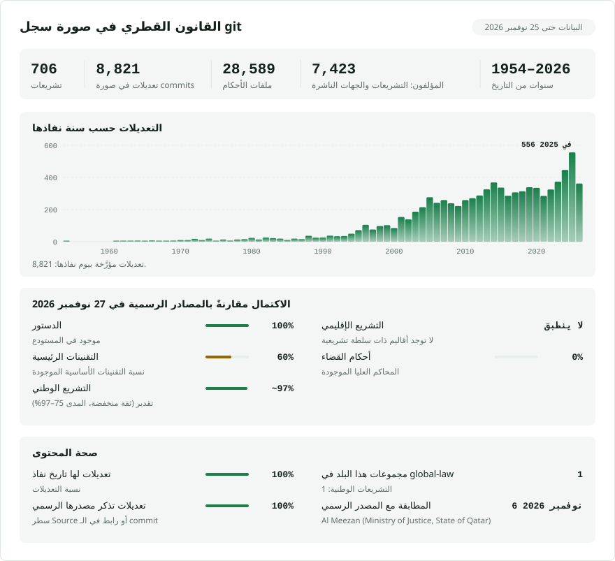

# قطر: تاريخ القانون في git

**العربية** · [English](README.en.md)

<picture>
<source media="(prefers-color-scheme: dark)" srcset="data/ar/effort-dark.svg">

</picture>

القانون القطري في صورة سجل git: ملف واحد لكل مادة، وcommit واحد لكل نسخة في يوم نفاذها، والتشريع الذي أجرى كل تعديل هو مؤلف الـ commit. يذكر `git blame` التشريع الذي يقف وراء كل مادة؛ ويسرد `git log` كل تعديل طرأ على مادة ما؛ واختيار تاريخ ما يعطي النص النافذ في ذلك اليوم.

جزء من [lexifina/global-law](https://github.com/lexifina/global-law)، وهو سجل git واحد لقوانين جميع الدول: هذا هو القانون الوطني القطري، الذي يقرؤه global-law في `qatar/national/acts/`.

**ما يحتويه الآن:** الدستور و1,713 تشريعًا من الميزان، البوابة القانونية لوزارة العدل، في 1,722 نسخة: 581 قانونًا، و125 مرسومًا بقانون، و300 قرار أميري (1996-2013)، و707 قرارات لمجلس الوزراء (1994-2026). للدستور (نسختان، الثانية من تعديلات 2024) ولقانون العقوبات (8 نسخ، من 2004 إلى 2024) تاريخهما الكامل المؤرَّخ؛ و188 تشريعًا يُظهرها الميزان معدَّلةً موجودة هنا بنصها الحالي فقط؛ وكل تشريع آخر موجود هنا كما صدر. يسرد [`data/laws.csv`](data/laws.csv) كل تشريع مع عنوانه وصفحته على الميزان؛ ويسرد [`data/versions.json`](data/versions.json) نسخ كل تشريع.

كل تشريع مجلد مسمّى `<kind>-<year>-<number>/`، فيه ملف واحد لكل مادة (`law-2004-14/` هو قانون العمل، القانون رقم (14) لسنة 2004، و`law-2004-14/art-079.md` هي المادة 79 منه، بشأن الإجازة السنوية)؛ وتحتفظ التشريعات الثلاثة الأولى المسجلة بأسمائها الخاصة: [`dustur/`](dustur/) (الدستور)، و[`qanun-al-uqubat/`](qanun-al-uqubat/) (قانون العقوبات، القانون رقم (11) لسنة 2004)، و[`himayat-al-bayanat-al-shakhsiya/`](himayat-al-bayanat-al-shakhsiya/) (القانون رقم (13) لسنة 2016 بشأن حماية خصوصية البيانات الشخصية). ويسرد `README.md` في كل مجلد مواده.

النص باللغة العربية، وهو النص المعتمد، كما ينشره الميزان. والترجمات الإنجليزية في الميزان جزئية وغير رسمية، وليست جزءًا من هذا السجل.

## الأسئلة بصيغة أوامر git

| السؤال | الأمر |
| --- | --- |
| كل تعديل طرأ على المادة 333 من قانون العقوبات (الخصوصية) | `git log -p --word-diff -- qanun-al-uqubat/art-333.md` |
| أي قانون كتب كل سطر من المادة 333؟ | `git blame qanun-al-uqubat/art-333.md` |
| كل نسخ قانون العقوبات، مع يوم نفاذ كل منها | `git log --format="%h %(trailers:key=In-force,valueonly,separator=) %an" -- qanun-al-uqubat ":^qanun-al-uqubat/README.md"` |
| المادة 333 كما كانت نافذة في 1 يناير 2015 | `python tools/on.py 2015-01-01 qanun-al-uqubat art-333` |

**خارج git**، نستضيف هذا السجل أيضًا للعموم مجانًا:

- **[اسأل Claude عن القانون القطري](https://global-law.lexifina.com/v1/try_claude?country=qatar)**: يفتح Claude مع سؤال أول جاهز.
- **[اسأل ChatGPT](https://global-law.lexifina.com/v1/try_chatgpt?country=qatar)**: السؤال نفسه في ChatGPT.
- **[ابحث في القانون القطري على موقعنا](https://lexifina.com/law?country=qatar&q=%D8%A5%D8%AC%D8%A7%D8%B2%D8%A9+%D8%B3%D9%86%D9%88%D9%8A%D8%A9)**: بحث عن "إجازة سنوية"، مع نص كل حكم ونسخه، دون الحاجة إلى حساب.
- **[واجهة REST API للمطورين](https://global-law.lexifina.com/v1/search_law?query=%D8%A5%D8%AC%D8%A7%D8%B2%D8%A9+%D8%B3%D9%86%D9%88%D9%8A%D8%A9&jurisdiction=qatar)**: البحث نفسه بصيغة JSON، دون مفتاح. انظر [التوثيق هنا](https://lexifina.com/api/global-law).

يقرأ كلا المساعدَين السجلَّ عبر موصل Global law المجاني (MCP، `https://global-law.lexifina.com/mcp`)؛ وفي المرة الأولى تعطيك المحادثة الرابط الذي يضيفه. اسأل بالعربية أو بالإنجليزية.

**استضِفه بنفسك بسهولة.** كل ما يلزم هو git وPython، والأدوات تعمل على جهازك:

```sh
git clone --depth 1 https://github.com/lexifina/global-law && cd global-law
python3 tools/countries.py add qatar/national/acts
python3 tools/law.py show 2026-01-01 qatar/national/acts/qanun-al-uqubat/art-333.md
```

عند فتح النسخة المستنسخة في Claude Code أو Cursor أو VS Code أو Codex، تشغّل أيضًا خادم MCP محليًا بالأدوات نفسها ([MCP.md](https://github.com/lexifina/global-law/blob/main/MCP.md)).

## التواريخ

يحمل كل commit تاريخ الظهر، بتوقيت Asia/Qatar، من يوم نفاذ النسخة، ويذكر هذا التاريخ في حقله الختامي (trailer) `In-force:`:

- نص النفاذ في التشريع نفسه، حيثما يسمح السجل بحسابه (يوم محدد، أو مدة تُحسب من تاريخ صدوره أو نشره في الجريدة الرسمية)؛ وقد نفذت التعديلات الدستورية لسنة 2024 عند إعلان نتيجة الاستفتاء، في 6 نوفمبر 2024 (المادة 2 منها)؛
- إذا لم يوجد مثل هذا النص، يُعمل بالقانون أو المرسوم بقانون المنشور اعتبارًا من 9 يونيو 2005 بعد شهر من نشره (الدستور، المادة 142)، ويؤرَّخ ما قبله بيوم صدوره؛ ويؤرَّخ القرار بيوم نشره في الجريدة الرسمية، أو بيوم صدوره حيث لا يسجّل الميزان إلا سنة الجريدة. وترد قاعدة كل تشريع في `REPRODUCE.md`؛
- لا يستطيع git تخزين تواريخ سابقة لعام 1970، لذا تحمل الـ commits الأربعة عشر الأقدم (قوانين ومراسيم بقوانين من 1961 إلى 1969) التاريخ 1970-01-01، مع اليوم الحقيقي في `In-force:`. استعلم عن تاريخ ما باستخدام `tools/on.py`، لا `git log --before`.

يُنسب كل تعديل على الدستور وقانون العقوبات إلى القانون الذي أجراه، كما يسمّيه سجل الميزان لتاريخ كل مادة. أما النسخة الوحيدة لكل تشريع آخر فتُنسب إلى التشريع نفسه (1,526 تشريعًا)، أو، حيث يُظهره الميزان معدَّلًا، إلى الناشر، الميزان، بوصفها "oldest version available" (أقدم نسخة متاحة) (188). وصاحب الـ commit (committer) هو Lexifina.

## طريقة التحقق

- يعيد `tools/check_repo.py` قراءة كل نسخة من git في يوم نفاذها وفي اليوم السابق له ويقارنها بالمجموعة، التي ترد قيمة تجزئتها في `data/corpus.sha256`؛ ويتحقق أيضًا من أن الحقول الختامية لكل commit قابلة للتحليل، وأن `main` لا يحتوي على commits دمج (merge)، وأنه لا يوجد commit مؤرَّخ بعد البناء. ويسجّل [`REPRODUCE.md`](REPRODUCE.md) إعادة قراءة 1,722 نسخة من 1,714 تشريعًا دون أي اختلاف.
- يُقارَن كذلك كل قرار أميري وكل قرار لمجلس الوزراء بملف Akoma Ntoso XML في الميزان، الذي يجب أن يحمل النص العربي نفسه؛ وما لا يطابقه يُستبعد.
- يكتب `tools/build.py` السجل من المجموعة، والمجموعة نفسها تعطي قيم تجزئة الـ commits نفسها؛ ويضيف `tools/append.py` التشريعات والنسخ الجديدة فوقه ولا يعيد كتابته أبدًا. ولم تُقارَن بعدُ أي عملية بناء ثانية.

## ما لا يتضمنه

- **النصوص السابقة للتشريعات المعدَّلة.** للتشريعات الـ 188 الموجودة بنصها الحالي (108 قوانين ومراسيم بقوانين، منها قانون العمل، و80 قرارًا) نسخة واحدة: القوانين والمراسيم بقوانين مؤرَّخة من بدء نفاذ التشريع نفسه، والقرارات من آخر تعديل لها، لذلك يعطي التاريخ الأقدم النص الحالي. وسيُضاف تاريخها المؤرَّخ فوقها.
- **المراسيم والقرارات الأخرى.** تُضاف المراسيم والقرارات الوزارية وقرارات الجهات الأخرى والقرارات الأميرية اللاحقة لعام 2013 على دفعات. أما الأدوات الفردية (التعيينات والترقيات والعفو والجنسية وما شابهها) والنصوص التي تحمل بيانات تعريف شخصية فمستبعدة عمدًا.
- **التشريعات غير النافذة.** لا يوجد هنا إلا ما يصفه الميزان بأنه نافذ، وتُستبعد المواد الملغاة من النصوص الحالية.
- **21 قانونًا ومرسومًا بقانون** ينشرها الميزان بمادة مكررة أو فارغة، إلى أن يُعالَج ذلك (مدرجة في `REPRODUCE.md`).
- **عناوين الأبواب والفصول**، فهي ليست ملفات.

## المصادر

| المصدر | النوع | النسخ السابقة | ملاحظات |
| --- | --- | --- | --- |
| [الميزان](https://almeezan.qa) (وزارة العدل) | البوابة القانونية الرسمية: الدستور والقوانين والمراسيم بقوانين والقرارات الأميرية وقرارات مجلس الوزراء، مع بيانات نشرها في الجريدة الرسمية | تاريخ كل مادة، مستخدَم للدستور وقانون العقوبات | النصوص العربية عبر واجهته البرمجية العامة، وآخر قراءة في 6 نوفمبر 2026؛ التشريعات الموصوفة بأنها نافذة فقط؛ الترجمات الإنجليزية غير مستخدمة |

## الترخيص

انظر [`LICENSE`](LICENSE). يستثني القانون رقم (7) لسنة 2002 بشأن حماية حق المؤلف والحقوق المجاورة، في البند (1) من المادة (4)، التشريعات من الحماية، بينما تطلب شروط استخدام الميزان إذنًا كتابيًا لنسخ محتواه؛ ويُنشر النص استنادًا إلى استثناء البند (1) من المادة (4)، وسيُسحب عند الطلب. أما السجل الذي أعدّته Lexifina ورسائل الـ commits والجداول والأدوات فخاضعة لـ CC0 1.0.

لم يكتب أي نموذج ذكاء اصطناعي نصًا قانونيًا ولم يترجمه ولم يصحّحه؛ أما البرامج النصية فقد كتبها نموذج ذكاء اصطناعي (انظر [`REPRODUCE.md`](REPRODUCE.md)).

هذا النص ترجمة للنسخة الإنجليزية ([README.en.md](README.en.md))؛ وعند الاختلاف تسود النسخة الإنجليزية.

## المزيد

من مستودع [lexifina/global-law](https://github.com/lexifina/global-law) (صفحات باللغة الإنجليزية):

- [FEATURES.md](https://github.com/lexifina/global-law/blob/main/FEATURES.md): جميع الميزات، وما يجب أن تدعمه كل مجموعة (`git blame`، `law.py`، أدوات MCP)
- [FAQ.md](https://github.com/lexifina/global-law/blob/main/FAQ.md): أسئلة وأجوبة · [CONTRIBUTING.md](https://github.com/lexifina/global-law/blob/main/CONTRIBUTING.md): اقتراح تغييرات · [MCP.md](https://github.com/lexifina/global-law/blob/main/MCP.md): خادم MCP · [REPRODUCE.md](https://github.com/lexifina/global-law/blob/main/REPRODUCE.md): طريقة البناء · [CHANGELOG.md](https://github.com/lexifina/global-law/blob/main/CHANGELOG.md)
- [FRESHNESS.md](https://github.com/lexifina/global-law/blob/main/FRESHNESS.md): مدى حداثة كل مجموعة · [المراقبة](https://github.com/lexifina/global-law/tree/main/monitoring): هل تعمل التحديثات · [WATCHING.md](https://github.com/lexifina/global-law/blob/main/WATCHING.md): كيف يُراقَب كل مصدر رسمي لرصد التغييرات
- [performance/](https://github.com/lexifina/global-law/tree/main/performance): سرعة الأدوات كما قيست
- [visualisations/](https://github.com/lexifina/global-law/tree/main/visualisations): رسوم بيانية وروابط عبر قوانين العالم
- [الثغرات](https://github.com/lexifina/global-law/tree/main/vulnerabilities): أخطاء في التشريعات كما نُشرت
