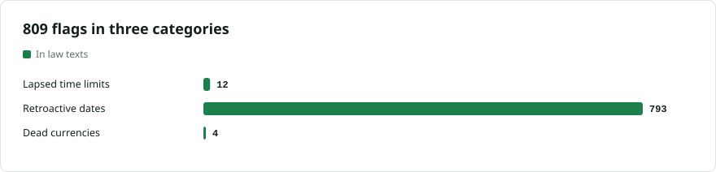

# Vulnerabilities in Qatari law

[العربية](README.md) · **English**

<picture>
<source media="(prefers-color-scheme: dark)" srcset="img/flags-by-category-dark.svg">

</picture>

The vulnerability detectors from [lexifina/global-law](https://github.com/lexifina/global-law/tree/main/vulnerabilities) look for mechanical mistakes in legislation: a rule applying "until" a date that has passed, a provision repealed before its replacement took effect, two amendments to the same provision on the same day, a reference to an article that no longer exists. global-law's published list (9 November 2026) had no flags for Qatar, so this is a run over this repository only, as it stood at commit [`78a0d30`](https://github.com/lexifina/qatar-law/commit/78a0d30fcdf05eba204ee79a4e1daf936902a496) on 16 November 2026: the Constitution and 1,713 acts (581 laws, 125 decree-laws, 300 Amiri decisions and 707 decisions of the Council of Ministers), in Arabic, as Al Meezan, the Ministry of Justice's legal portal, publishes them. The detectors did not read a period "ending on" a date in Arabic, or the rupee, until they were fixed for this run (below).

**In short:** the detectors raised 809 flags: 793 retroactive dates, 12 lapsed time limits and 4 amounts in a dead currency. A language model reviewed 52 of them (all 12 time limits and the 40 strongest retroactive dates), arguing each one for and against; 7 survived, all retroactive dates. Checked by hand, none is a drafting mistake: the 7 acts each say that they take effect from the day they were issued, as 659 other flagged acts do; the 12 time limits are periods that have run their course (seven extensions of the Shura Council's term among them); the 4 amounts are fines and a fee in rupees in laws of 1963 and 1966. Reading the flags turned up problems in this repository instead, listed below: 22 acts dated in force before the day their own words, or this repository's rules, put them in force; a tax exemption in the Qatar Financial Centre Law whose text no longer matches the Official Gazette or its own next paragraph; a word missing from a 1966 penalty; and an act numbered (0). Later, this will be formalised in Lean, similar to our work on [the US tax code](https://lexifina.com/blog/formalizing-the-us-tax-code) and [US case law](https://lexifina.com/blog/formalizing-all-us-case-law-in-lean).

A flag is a prompt to look, not legal advice, and nothing here has been tested in court.

## Flags by category

| Category | What it looks for | Flags | In law texts | Reviewed | Survived review |
| --- | --- | ---: | ---: | ---: | ---: |
| Lapsed time limits | Text still applying a rule "until" a date that has passed | 12 | 12 | 12 | 0 |
| Retroactive or pre-publication dates | A law dated in force before it was published | 793 | 793 | 40 | 7 |
| Dead currencies | An amount in a currency that has since been replaced | 4 | 4 | 0 | 0 |

"In law texts" counts all the law this repository holds: the Constitution (`dustur/`), the Penal Code (`qanun-al-uqubat/`), the personal data law (`himayat-al-bayanat-al-shakhsiya/`) and every other act (`<kind>-<year>-<number>/`: laws, decree-laws, Amiri decisions and decisions of the Council of Ministers, which bind as regulations), one file per article. The other files are the READMEs, the root files (the licence, `REPRODUCE.md`, `jurisdiction.json`), `data/` and `tools/`; none has a flag. The history detectors have little to read: only the Constitution (2 versions) and the Penal Code (8 versions) have a dated history of amendments; 188 acts are held as today's text, credited to the publisher, and every other act as issued, in one version. The search for repeal gaps, same-day conflicts, empty periods, stale amounts and references to deleted provisions found nothing. Most of the retroactive dates (666 of 793) are acts that take effect on the day they were issued and were published in the Official Gazette later, which Qatari law allows (Constitution, Article 142: a law takes effect one month after publication "unless the law itself sets another date"). The time-limit search reads "حتى" or "لغاية" (until) and, since this run, "تنتهي في" (ending on) before a date; the law texts write their dates in Western digits (Arabic-Indic digits occur in four article files).

*Edge cases: what the 809 flags are, checked by hand, and the problems in this repository in detail, in [EDGE-CASES.en.md](EDGE-CASES.en.md).*

## Problems found in this repository

- **22 acts dated in force too early.** Each commit is dated by the act's own in-force clause, or by the rules in the README (Constitution, Article 142, for a law; the Gazette day for a decision with no clause). For 14 acts the build did not read the clause (a spelling it did not expect, such as "تاریخ" with a Persian "ی", "اليوم التالي التاريخ نشره", "01/ 01/ 2027" or "2025/01/01"; a phrase elsewhere in the act that it took for the clause; a clause that ties the act to another act's start) and dated the act by its day of issue. The furthest out is [Law No. 13 of 2026](https://github.com/lexifina/qatar-law/tree/78a0d30fcdf05eba204ee79a4e1daf936902a496/law-2026-13), amending the real estate brokerage law: it says "ويُعمل به اعتبارًا من تاريخ 01/ 01/ 2027" but is held as in force since 2 September 2026. Eight decisions with no in-force clause (five Council of Ministers decisions of 2001, one of 2002 and two Amiri decisions of 1998 and 1999) are dated by their day of issue, though the Gazette day is in the record. The list is in [EDGE-CASES.en.md](EDGE-CASES.en.md).
- **Article 17 of the Qatar Financial Centre Law** ([`law-2005-7/art-017.md`](https://github.com/lexifina/qatar-law/blob/78a0d30fcdf05eba204ee79a4e1daf936902a496/law-2005-7/art-017.md), Law No. 7 of 2005): paragraph 2 exempts the Centre's entities and staff from taxes "لمدة تبدأ من أول مايو 2008 وتنتهي في 31 ديسمبر 2009", and paragraph 3 still speaks of "the end of the three years referred to in the preceding paragraph". In the Official Gazette (No. 5 of 2005, page 106) paragraph 2 reads "لمدة ثلاث سنوات تبدأ من تاريخ العمل بهذا القانون"; Law No. 14 of 2009 (Article 2) extended that period "for another period" from 1 May 2008 to 31 December 2009 without replacing the words. The text held here, Al Meezan's, has the extension in place of the three years.
- **A word missing from Article 5(a) of Decree-Law No. 10 of 1966 on price fixing** ([`decree-law-1966-10/art-005.md`](https://github.com/lexifina/qatar-law/blob/78a0d30fcdf05eba204ee79a4e1daf936902a496/decree-law-1966-10/art-005.md)): "وبغرامة تجاوز خمسة آلاف روبية" (a fine exceeding five thousand rupees); the Official Gazette (No. 4 of 1966, page 1339) reads "وبغرامة لا تجاوز خمسة آلاف روبية" (not exceeding).
- **Law No. (0) of 2000:** the law establishing the Qatar General Electricity and Water Corporation is held as [`law-2000-0/`](https://github.com/lexifina/qatar-law/tree/78a0d30fcdf05eba204ee79a4e1daf936902a496/law-2000-0), "القانون رقم (0) لسنة 2000", as Al Meezan numbers it; the ten acts in this repository that cite it in their preambles (among them Law No. 26 of 2008 and Decree-Law No. 18 of 2009) call it Law No. (10) of 2000. A 1994 law amending the old Penal Code is held the same way, as `law-1994-0/`.
- **A committee decision among the Amiri decisions:** [`emiri-decision-2004-2/`](https://github.com/lexifina/qatar-law/tree/78a0d30fcdf05eba204ee79a4e1daf936902a496/emiri-decision-2004-2) holds Decision No. 2 of 2004 of the Supreme Committee for Coordination and Follow-up, which Al Meezan files under Amiri decisions; it is counted among the 300 Amiri decisions.

## Files

| File | What it holds |
| --- | --- |
| [data/flags.csv](data/flags.csv) | Every flag, one row per provision and issue |
| [data/reviewed.csv](data/reviewed.csv) | The 52 flags the model reviewed, with its verdict and reason |
| [data/by_category.csv](data/by_category.csv) | The counts in the table above |
| [tools/](tools/) | The scripts that made this run |

Columns: `category` and `category_ar` (the category in English and Arabic), `detector`, `kind` (`law` or `other`), `path` (the article in this repository; for a retroactive date, the act's first article), `date` (the date the flag turns on), `reference` (the act involved; for a lapsed time limit, the act or publisher the version is credited to; for a dead currency, the line), `summary`, `score` (the detector's ranking, 0 to 1), `review` (`artefact`, `lawful` or `candidate_defect`), `survives_rebuttal`, `review_note` (the model's reason, in English), `url` (the article at the commit that was read; for a retroactive date, the act's commit).

## How it was made

- **Detectors:** global-law's [vulnerabilities/scripts](https://github.com/lexifina/global-law/tree/main/vulnerabilities/scripts), with the fixes in [tools/](tools/README.md) (among them `patch_ar.py`, which teaches the time-limit search Arabic "until" and month names, and `patch_qa.py`, written for this run, which adds "ending on" and the rupee), run on this repository at commit `78a0d30`. The history table the detectors read was built from this repository's own commits (the act or publisher each version is credited to, and the `In-force` and `Kind` trailers): the 606 commits of kind `law`, 927 of kind `decree`, 188 of kind `publisher` and the 2024 constitutional referendum count as changes to the law. The corpus language is Arabic.
- **Model review:** gpt-5.4-mini, the 40 strongest flags per category (here all 12 lapsed time limits and 40 of the 793 retroactive dates; the dead currencies are not reviewed); one pass says whether a flag is real, a second argues that it is not. There were no empty periods to review.
- **Hand check:** every flag that survived, every lapsed time limit and every dead currency was read in this repository's text and history; every retroactive date was sorted by the act's in-force clause as `REPRODUCE.md` records it and read in the act's text. Every reference in the Constitution and the Penal Code to an article of the same act was checked against the articles this repository holds. The Official Gazette pages for Law No. 7 of 2005 and Decree-Law No. 10 of 1966 were read in the copies Al Meezan links, and its record of Article 17 of Law No. 7 of 2005; nothing else was compared with the Gazette.

To report a correction, open an issue with the provision and an official source.

## Licence

The lists and notes are Lexifina's, dedicated to the public domain under CC0 1.0, like the rest of this repository's own contributions. Quoted law text is as Al Meezan publishes it. Law No. 7 of 2002 on the Protection of Copyright and Neighbouring Rights, Article 4(1), excludes legislation from protection, while Al Meezan's terms of use ask for written permission to copy its content; the text is quoted under the Article 4(1) exemption. See [LICENSE](../LICENSE).
