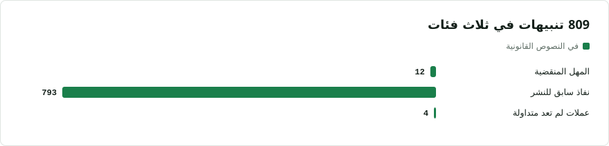

# الثغرات في القانون القطري

**العربية** · [English](README.en.md)

<picture>
<source media="(prefers-color-scheme: dark)" srcset="img/flags-by-category-dark.ar.svg">

</picture>

تبحث أدوات رصد الثغرات في مستودع [lexifina/global-law](https://github.com/lexifina/global-law/tree/main/vulnerabilities) عن الأخطاء الآلية في التشريعات: حكم يسري "حتى" تاريخ انقضى، أو حكم أُلغي قبل نفاذ الحكم الذي يحل محله، أو تعديلان للحكم نفسه في اليوم نفسه، أو إحالة إلى مادة لم تعد قائمة. ولم تتضمن القائمة التي نشرها global-law (في 9 نوفمبر 2026) أي تنبيه لقطر، لذا فهذا تشغيل على هذا المستودع وحده، كما كان عند الـ commit [`78a0d30`](https://github.com/lexifina/qatar-law/commit/78a0d30fcdf05eba204ee79a4e1daf936902a496) في 16 نوفمبر 2026: الدستور و1,713 تشريعًا (581 قانونًا، و125 مرسومًا بقانون، و300 قرار أميري، و707 قرارات لمجلس الوزراء)، باللغة العربية، كما ينشرها الميزان، البوابة القانونية لوزارة العدل. ولم تكن الأدوات تقرأ المدة التي "تنتهي في" تاريخ معين بالعربية، ولا الروبية، حتى أُصلحت لهذا التشغيل (انظر أدناه).

**باختصار:** أصدرت الأدوات 809 تنبيهات: 793 تاريخ نفاذ سابقًا للنشر، و12 مهلة منقضية، و4 مبالغ بعملة لم تعد متداولة. وراجع نموذج لغوي 52 تنبيهًا منها (المهل الاثنتي عشرة كلها، وأقوى 40 تنبيهًا بالنفاذ السابق للنشر)، فاحتج لكل منها وعليه؛ وصمد منها 7، كلها من النفاذ السابق للنشر. وبالتحقق اليدوي لا يمثل أي منها خطأً في الصياغة: فكل من التشريعات السبعة ينص على العمل به من تاريخ صدوره، شأنه شأن 659 تشريعًا آخر نُبِّه إليه؛ والمهل الاثنتا عشرة مدد استنفدت غرضها (منها سبعة قرارات بمد مدة مجلس الشورى)؛ والمبالغ الأربعة غرامات ورسم بالروبية في قانونين من سنة 1963 ومرسوم بقانون من سنة 1966. وبدلًا من ذلك كشفت قراءة التنبيهات مشكلات في هذا المستودع، مذكورة أدناه: 22 تشريعًا مؤرَّخًا نفاذه قبل اليوم الذي يحدده نصه أو قواعد هذا المستودع؛ وإعفاء ضريبي في قانون مركز قطر للمال لم يعد نصه يطابق الجريدة الرسمية ولا البند الذي يليه؛ وكلمة ساقطة من عقوبة في مرسوم بقانون لسنة 1966؛ وتشريع رقمه (0). وسيُصاغ هذا لاحقًا صياغة رسمية بلغة Lean، على غرار عملنا على [قانون الضرائب الأمريكي](https://lexifina.com/blog/formalizing-the-us-tax-code) و[السوابق القضائية الأمريكية](https://lexifina.com/blog/formalizing-all-us-case-law-in-lean).

التنبيه دعوة إلى النظر، لا استشارة قانونية، ولم يُختبر شيء مما هنا أمام القضاء.

## التنبيهات حسب الفئة

| الفئة | ما تبحث عنه | التنبيهات | في النصوص القانونية | رُوجعت | صمدت بعد المراجعة |
| --- | --- | ---: | ---: | ---: | ---: |
| المهل المنقضية | نص ما زال يُعمل بحكمه "حتى" تاريخ انقضى | 12 | 12 | 12 | 0 |
| نفاذ سابق للنشر | تشريع مؤرَّخ نفاذه قبل نشره | 793 | 793 | 40 | 7 |
| عملات لم تعد متداولة | مبلغ بعملة حلت محلها عملة أخرى | 4 | 4 | 0 | 0 |

يشمل عمود "في النصوص القانونية" كل ما في هذا المستودع من قانون: الدستور (`dustur/`)، وقانون العقوبات (`qanun-al-uqubat/`)، وقانون حماية خصوصية البيانات الشخصية (`himayat-al-bayanat-al-shakhsiya/`)، وسائر التشريعات (`<kind>-<year>-<number>/`: القوانين والمراسيم بقوانين والقرارات الأميرية وقرارات مجلس الوزراء، وهي ملزمة بوصفها لوائح)، بملف لكل مادة. أما الملفات الأخرى فهي ملفات README، والملفات الجذرية (الترخيص، و`REPRODUCE.md`، و`jurisdiction.json`)، و`data/` و`tools/`؛ ولا تنبيه في أي منها. ولا تجد أدوات التاريخ إلا القليل لتقرأه: فلا تاريخ مؤرَّخًا للتعديلات إلا للدستور (نسختان) وقانون العقوبات (8 نسخ)؛ ويوجد 188 تشريعًا بنصها الحالي منسوبًا إلى الناشر، وكل تشريع آخر كما صدر، في نسخة واحدة. ولم يُسفر البحث عن الفراغ بعد الإلغاء، والتعديلات في اليوم نفسه، والفترات غير المشمولة، والمبالغ التي لم تُحدَّث، والإحالات إلى أحكام محذوفة عن شيء. وأغلب تواريخ النفاذ السابقة للنشر (666 من 793) تشريعات يُعمل بها من تاريخ صدورها ونُشرت في الجريدة الرسمية بعد ذلك، وهو ما يجيزه القانون القطري (المادة 142 من الدستور: يُعمل بالقانون بعد شهر من تاريخ نشره "ما لم ينص على تاريخ آخر في القانون ذاته"). ويقرأ البحث عن المهل "حتى" و"لغاية"، ومنذ هذا التشغيل "تنتهي في"، قبل التاريخ؛ وتكتب النصوص القانونية تواريخها بالأرقام العربية الغربية (ولا ترد الأرقام الهندية إلا في أربعة ملفات مواد).

*الحالات الحدية: ما هي التنبيهات الـ 809 بعد التحقق اليدوي، وتفاصيل المشكلات في هذا المستودع، في [EDGE-CASES.md](EDGE-CASES.md).*

## مشكلات وُجدت في هذا المستودع

- **22 تشريعًا مؤرَّخًا نفاذه قبل أوانه.** يؤرَّخ كل commit بنص النفاذ في التشريع نفسه، أو بالقواعد الواردة في ملف README (المادة 142 من الدستور للقانون؛ ويوم النشر في الجريدة الرسمية للقرار الذي لا نص نفاذ فيه). ففي 14 تشريعًا لم يقرأ البناءُ نصَّ النفاذ (لكتابة لم يتوقعها، مثل "تاریخ" بالياء الفارسية "ی"، و"اليوم التالي التاريخ نشره"، و"01/ 01/ 2027"، و"2025/01/01"؛ أو لعبارة في موضع آخر من التشريع حسبها نصَّ النفاذ؛ أو لنص يربط النفاذ ببدء العمل بتشريع آخر)، فأرّخ التشريع بيوم صدوره. وأبعدها أثرًا [القانون رقم (13) لسنة 2026](https://github.com/lexifina/qatar-law/tree/78a0d30fcdf05eba204ee79a4e1daf936902a496/law-2026-13) بتعديل بعض أحكام قانون تنظيم أعمال الوساطة العقارية: ينص على أنه "يُعمل به اعتبارًا من تاريخ 01/ 01/ 2027"، لكنه مسجَّل نافذًا منذ 2 سبتمبر 2026. ويؤرَّخ ثمانية قرارات لا نص نفاذ فيها (خمسة قرارات لمجلس الوزراء لسنة 2001، وقرار لسنة 2002، وقراران أميريان لسنتي 1998 و1999) بيوم صدورها، مع أن يوم النشر في الجريدة الرسمية مسجَّل في السجل. والقائمة في [EDGE-CASES.md](EDGE-CASES.md).
- **المادة (17) من قانون مركز قطر للمال** ([`law-2005-7/art-017.md`](https://github.com/lexifina/qatar-law/blob/78a0d30fcdf05eba204ee79a4e1daf936902a496/law-2005-7/art-017.md)، القانون رقم (7) لسنة 2005): يعفي البند 2 الكيانات الموجودة في المركز والعاملين فيه من الضرائب "لمدة تبدأ من أول مايو 2008 وتنتهي في 31 ديسمبر 2009"، وما زال البند 3 يتحدث عن "انتهاء السنوات الثلاث المشار إليها في البند السابق". ونص البند 2 في الجريدة الرسمية (العدد 5 لسنة 2005، الصفحة 106): "لمدة ثلاث سنوات تبدأ من تاريخ العمل بهذا القانون"؛ ثم مدّ القانون رقم (14) لسنة 2009 (المادة 2) هذه المدة "لمدة أخرى" من أول مايو 2008 إلى 31 ديسمبر 2009 دون أن يستبدل النص. أما النص المسجَّل هنا، وهو نص الميزان، فقد وضع مدة التمديد مكان السنوات الثلاث.
- **كلمة ساقطة من البند (أ) من المادة (5) من المرسوم بقانون رقم (10) لسنة 1966 بشأن تثبيت الأسعار** ([`decree-law-1966-10/art-005.md`](https://github.com/lexifina/qatar-law/blob/78a0d30fcdf05eba204ee79a4e1daf936902a496/decree-law-1966-10/art-005.md)): "وبغرامة تجاوز خمسة آلاف روبية"؛ والنص في الجريدة الرسمية (العدد 4 لسنة 1966، الصفحة 1339): "وبغرامة لا تجاوز خمسة آلاف روبية".
- **القانون رقم (0) لسنة 2000:** قانون إنشاء المؤسسة العامة القطرية للكهرباء والماء مسجَّل في [`law-2000-0/`](https://github.com/lexifina/qatar-law/tree/78a0d30fcdf05eba204ee79a4e1daf936902a496/law-2000-0) باسم "القانون رقم (0) لسنة 2000"، كما يرقّمه الميزان؛ أما التشريعات العشرة في هذا المستودع التي تشير إليه في ديباجاتها (ومنها القانون رقم (26) لسنة 2008 والمرسوم بقانون رقم (18) لسنة 2009) فتسمّيه القانون رقم (10) لسنة 2000. ومثله قانون صادر سنة 1994 بتعديل قانون العقوبات القديم، المسجَّل في `law-1994-0/`.
- **قرار لجنة بين القرارات الأميرية:** يحتوي [`emiri-decision-2004-2/`](https://github.com/lexifina/qatar-law/tree/78a0d30fcdf05eba204ee79a4e1daf936902a496/emiri-decision-2004-2) على قرار اللجنة العليا للتنسيق والمتابعة رقم (2) لسنة 2004، الذي يصنّفه الميزان ضمن القرارات الأميرية؛ وهو محسوب ضمن القرارات الأميرية الـ 300.

## الملفات

| الملف | ما يحتويه |
| --- | --- |
| [data/flags.csv](data/flags.csv) | كل التنبيهات، صف لكل حكم ومسألة |
| [data/reviewed.csv](data/reviewed.csv) | التنبيهات الـ 52 التي راجعها النموذج، مع حكمه وسببه |
| [data/by_category.csv](data/by_category.csv) | الأعداد الواردة في الجدول أعلاه |
| [tools/](tools/) | البرامج النصية التي أُجري بها هذا التشغيل |

الأعمدة: `category` و`category_ar` (الفئة بالإنجليزية والعربية)، و`detector`، و`kind` (`law` أو `other`)، و`path` (المادة في هذا المستودع؛ وفي النفاذ السابق للنشر، المادة الأولى من التشريع)، و`date` (التاريخ الذي يدور عليه التنبيه)، و`reference` (التشريع المعني؛ وفي المهل المنقضية، التشريع أو الجهة الناشرة التي تُنسب إليها النسخة؛ وفي العملات، رقم السطر)، و`summary`، و`score` (ترتيب الأداة، من 0 إلى 1)، و`review` (`artefact` أو `lawful` أو `candidate_defect`)، و`survives_rebuttal`، و`review_note` (سبب النموذج، بالإنجليزية)، و`url` (المادة عند الـ commit الذي قُرئ؛ وفي النفاذ السابق للنشر، الـ commit الخاص بالتشريع).

## طريقة الإعداد

- **الأدوات:** [vulnerabilities/scripts](https://github.com/lexifina/global-law/tree/main/vulnerabilities/scripts) من global-law، مع الإصلاحات الواردة في [tools/](tools/README.md) (ومنها `patch_ar.py`، الذي يُعلِّم البحثَ عن المهل كلمتَي "حتى" و"لغاية" وأسماء الشهور، و`patch_qa.py`، الذي كُتب لهذا التشغيل ويضيف "تنتهي في" والروبية)، شُغِّلت على هذا المستودع عند الـ commit `78a0d30`. وبُني جدول التاريخ الذي تقرؤه الأدوات من commits هذا المستودع نفسه (التشريع أو الجهة الناشرة التي تُنسب إليها كل نسخة، وتذييلات `In-force` و`Kind`): وتُعد الـ commits الـ 606 من نوع `law`، والـ 927 من نوع `decree`، والـ 188 من نوع `publisher`، واستفتاء التعديلات الدستورية لسنة 2024، تعديلات في القانون. ولغة المجموعة هي العربية.
- **مراجعة النموذج:** gpt-5.4-mini، أقوى 40 تنبيهًا في كل فئة (أي هنا المهل المنقضية الاثنتا عشرة كلها، و40 من تواريخ النفاذ السابقة للنشر الـ 793؛ ولا تُراجَع العملات)؛ تقرر جولة أولى ما إذا كان التنبيه حقيقيًا، وتحتج جولة ثانية بأنه ليس كذلك. ولم تكن هناك فترات غير مشمولة لمراجعتها.
- **التحقق اليدوي:** قُرئ في نص هذا المستودع وتاريخه كل تنبيه صمد، وكل مهلة منقضية، وكل مبلغ بعملة لم تعد متداولة؛ وصُنِّف كل تاريخ نفاذ سابق للنشر بحسب نص النفاذ في التشريع كما يسجّله `REPRODUCE.md`، وقُرئ في نص التشريع. وقُوبلت كل إحالة في الدستور وقانون العقوبات إلى مادة من التشريع نفسه بالمواد التي يحتويها هذا المستودع. وقُرئت صفحات الجريدة الرسمية الخاصة بالقانون رقم (7) لسنة 2005 والمرسوم بقانون رقم (10) لسنة 1966 في النسخ التي يحيل إليها الميزان، وكذلك سجل الميزان للمادة (17) من القانون رقم (7) لسنة 2005؛ ولم يُقابَل شيء آخر بالجريدة الرسمية.

للإبلاغ عن تصحيح، افتح issue يذكر الحكم ومصدرًا رسميًا.

## الترخيص

القوائم والملاحظات من عمل Lexifina، وهي مُهداة إلى الملك العام بموجب CC0 1.0، شأنها شأن سائر ما أسهمت به Lexifina في هذا المستودع. والنص القانوني المقتبس كما ينشره الميزان. ويستثني القانون رقم (7) لسنة 2002 بشأن حماية حق المؤلف والحقوق المجاورة، في البند (1) من المادة (4)، التشريعات من الحماية، بينما تطلب شروط استخدام الميزان إذنًا كتابيًا لنسخ محتواه؛ ويُقتبس النص استنادًا إلى استثناء البند (1) من المادة (4). انظر [LICENSE](../LICENSE).

هذا النص ترجمة للنسخة الإنجليزية ([README.en.md](README.en.md))؛ وعند الاختلاف تسود النسخة الإنجليزية.
